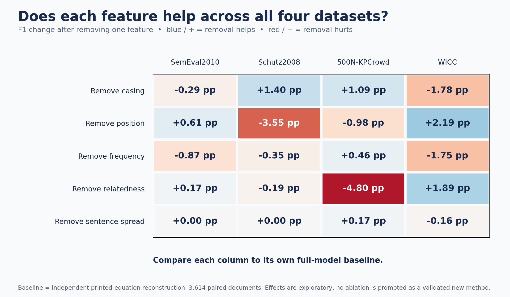
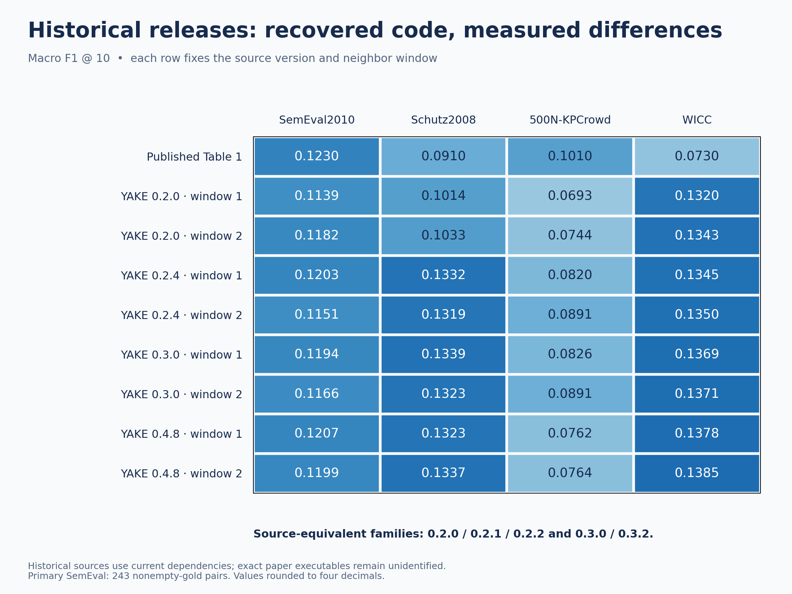

# YAKE! — Automatic Keyword Extraction

**Joshua Rebello · SAP ID 70562200090 · B.Tech AI & DS, 4th year**

A reproduction study of Campos et al., **A Text Feature Based Automatic Keyword Extraction Method for Single Documents**, ECIR 2018, Springer LNCS 10772, pp. 684–691. [Paper / DOI](https://doi.org/10.1007/978-3-319-76941-7_63).

YAKE extracts keywords using casing, position, frequency, context and sentence spread. It scores and ranks phrases from a single document without supervised training. This project compares the package implementation, an independent reconstruction, TextRank, SingleRank, TF-IDF and RAKE.

## Start here

| What you need | Where to find it |
|---|---|
| Results and interpretation | [Project report](docs/REPORT.md) |
| How to explain and demonstrate the project | [Presentation script](docs/PRESENTATION.md) |
| Settings, equations, sources and reproduction commands | [Protocol](docs/PROTOCOL.md) |
| Concrete successes and failures | [Error casebook](docs/CASEBOOK.md) |
| Every published/run P/R/F1 comparison | [Comparison CSV](results/comparison.csv) |
| Compact results for all experiments | [Results JSON](results/summary.json) |
| Original code, manifests, tests and per-document evidence | [Evidence ZIP](results/evidence.zip) |

## Results

The primary comparison evaluates **3,614 documents × six configurations = 21,684 evaluations**. The fidelity audit adds **144,872 evaluations**, including five feature ablations and thirteen one-choice sensitivities on all four datasets, historical implementations and a separate 244-text stemmed SemEval experiment. The archived test suite passed **31 tests**.

| Dataset | Primary documents | Paper YAKE F1 | Our package F1 | Independent reconstruction F1 |
|---|---:|---:|---:|---:|
| SemEval2010 | 243 | 0.1230 | 0.1207 | 0.0608 |
| Schutz2008 | 1,231 | 0.0910 | 0.1323 | 0.1157 |
| 500N-KPCrowd | 500 | 0.1010 | 0.0762 | 0.1506 |
| WICC | 1,640 | 0.0730 | 0.1378 | 0.0986 |

Scores use casefolded, whitespace-normalized exact matching, ten prediction slots, and mean document F1. Higher scores do **not** establish superiority over the paper: original executable settings, POS-tagged inputs, comparable unstemmed C-86 gold and original per-document author outputs remain unavailable. The separate 244-text stemmed experiment uses a different protocol and is not merged into this table.


## Fidelity audit

Historical YAKE source families, recovered C++ baselines and preconference RAKE were executed using declared dependencies and adaptations. Paired statistics include seeded bootstrap intervals and Holm corrections within declared families. These are exploratory comparisons of our own outputs.



Removing relatedness hurts news but helps WICC in this reconstruction. Feature effects depend on the dataset and configuration.



Recovered releases change the measured results, but do not identify the exact build used to produce the paper table. The [report](docs/REPORT.md) explains all remaining boundaries.

## Run the project

Use Python 3.9 with the pinned environment used for the experiments. If you already have `.venv_full`, activate it. For a fresh clone:

```bash
python3 -m venv .venv_full
source .venv_full/bin/activate
python -m pip install -r requirements.txt
python project.py prepare
python project.py test
```

One launcher exposes every active workflow:

```bash
python project.py extract --text "Natural language processing extracts important keywords from documents."
python project.py compare --limit 2
python project.py compare
python project.py walkthrough
python project.py verify
```

`compare --limit 2` is a smoke run, not a final score. Full comparisons create timestamped local folders; the pinned published evidence remains in the ZIP. `walkthrough` exports document, tokens, features, candidates, ranked phrases and gold labels locally. YAKE has no training epochs; POS models are reused pretrained dependencies and TF-IDF computes unlabeled corpus statistics.

For audit experiments, resume rules, C++ compiler requirements and analysis commands, use the [protocol](docs/PROTOCOL.md). `python project.py COMMAND --help` shows the options for an experiment.

## Repository layout

```text
NLP_PROJECT/
├── README.md
├── project.py              # One command launcher
├── requirements.txt        # One pinned environment
├── replication/            # Independent scorers and historical adapters
├── scripts/                # Active experiment workflows
├── tests/                  # Verification suite
├── configs/                # Paper settings and source provenance
├── docs/                   # Report, protocol, presentation and casebook
├── assets/figures/          # Four readable result figures
└── results/                # Compact summaries, comparison and evidence ZIP
```

The repository was simplified from **129 to 38 tracked files**. Older prototypes, overlapping reports, source snapshots and full public evidence are preserved byte-for-byte in the ZIP and Git history. Run `python project.py verify` to verify the archive and every original file hash. `python project.py evidence --restore` restores missing result files locally without overwriting existing files; generated folders remain ignored by Git. Older local run folders are kept under `.cache/archived_results`; the restore command also recovers their private prediction files when available. Raw datasets, full prediction dumps, caches and environments stay local.

## Attribution

[YAKE](https://github.com/INESCTEC/yake) · [Pinned PKE](https://github.com/boudinfl/pke/tree/69871ffdb720b83df23684fea53ec8776fd87e63) · [Datasets](https://github.com/INESCTEC/KeywordExtractor-Datasets) · [spaCy models](https://github.com/explosion/spacy-models).

The independent reconstruction, local RAKE and experiment pipeline are project code developed with AI assistance. YAKE, PKE and pretrained POS models are attributed reused dependencies. See the protocol and archived source provenance for historical adaptations.
