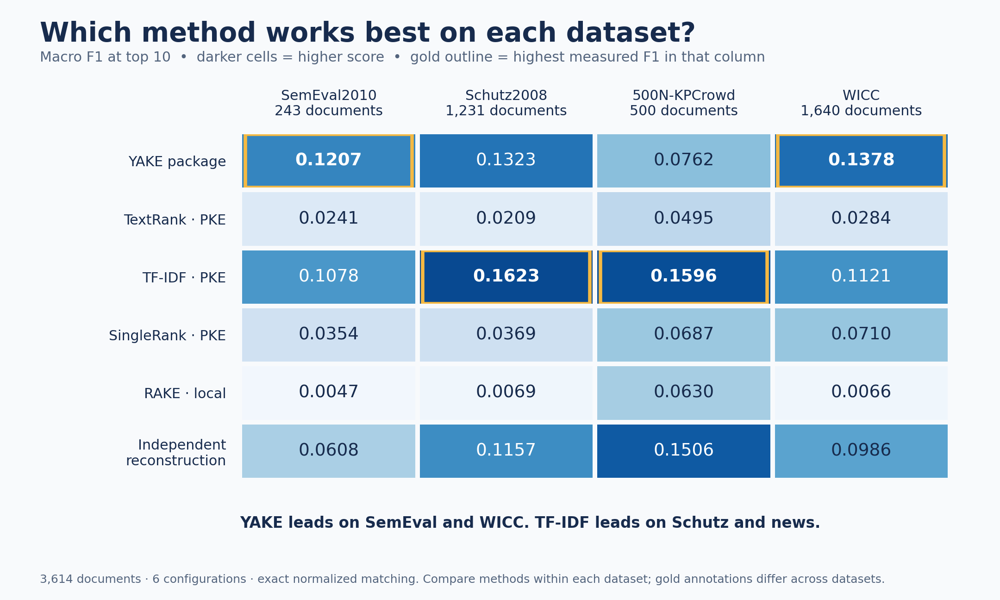
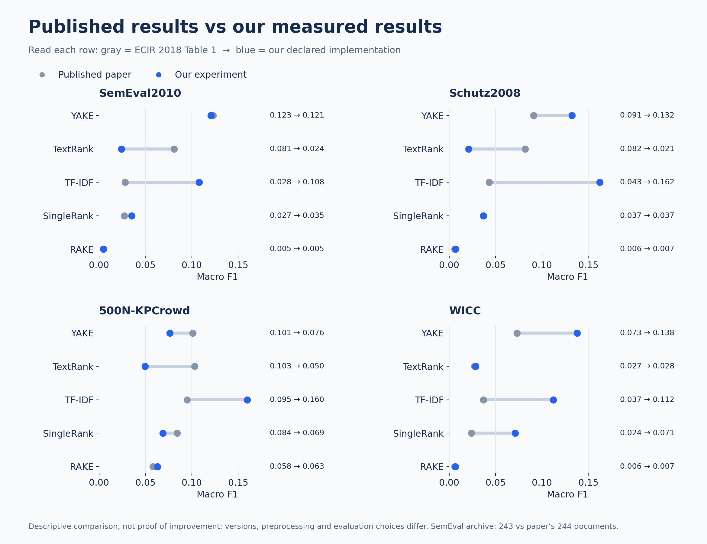
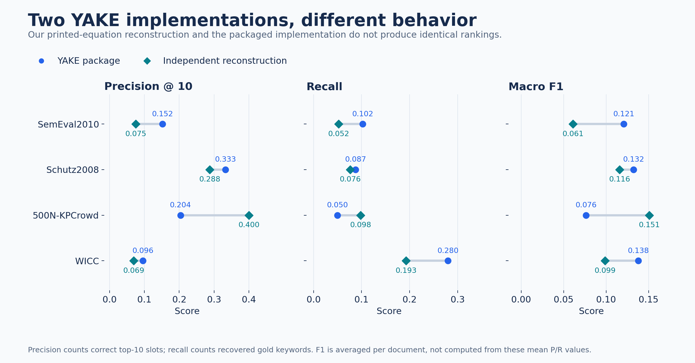
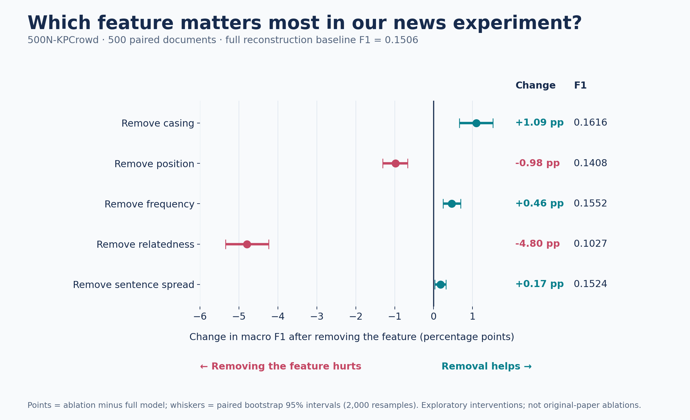

# 📄 YAKE! — Automatic Keyword Extraction
### Research Paper Reproduction & Four-Dataset Comparison

> **Paper:** *A Text Feature Based Automatic Keyword Extraction Method for Single Documents*  
> Campos, R., Mangaravite, V., Pasquali, A., Jorge, A., Nunes, C., & Jatowt, A. (**ECIR 2018**)  
> Springer, Lecture Notes in Computer Science **10772**, pp. **684–691**  
> [Publisher record](https://link.springer.com/chapter/10.1007/978-3-319-76941-7_63) · [DOI: 10.1007/978-3-319-76941-7_63](https://doi.org/10.1007/978-3-319-76941-7_63)

**Joshua Rebello** · **SAP ID: 70562200090**  
**B.Tech AI & DS — 4th year** · Natural Language Processing mini-project

---

## 🧠 Overview

This repository studies **YAKE!**, an unsupervised method that extracts keywords from a single document using local statistical features. It evaluates the **four datasets and five named methods** in the paper's Table 1, alongside an **independent reconstruction of the printed YAKE equations**.

The implementation computes word features, scores contiguous keyword candidates, filters invalid phrases, removes near duplicates, and evaluates the top ten predictions against human-provided gold keywords.

The project includes:

- **3,614 documents** across English and Spanish benchmarks.
- **Six configurations** and **21,684 document–method evaluations**.
- An independent equation-based scorer and a public YAKE-package reference.
- TextRank, SingleRank and TF-IDF through pinned PKE implementations, plus local RAKE.
- Five feature ablations on the 500N news dataset.
- **16 passing tests**, complete document-level metrics and independently verified score aggregation.
- Timestamped results, source/data hashes, resumable execution and four-dataset walkthroughs.

> **Reproduction scope:** This is full Table 1 coverage using documented current implementations, not verified publication-time executable equivalence. The available SemEval2010 archive contains **243 documents**, versus **244** described in the paper. Numerically higher results do not establish a controlled improvement over the original system.

---

## 📁 Project Structure

```text
NLP_PROJECT/
├── replication/
│   └── core.py                       # Independent word/phrase equation scorer
├── configs/
│   ├── paper.json                    # Independent experiment configuration
│   └── paper_table1.json              # Published scores and method labels
├── tests/
│   ├── test_replication.py            # Scoring, boundaries, casing and metrics
│   └── test_full_comparison.py        # POS, IDF, RAKE, Spanish and dataset checks
├── full_comparison.py                 # Four-dataset benchmark and resumable output
├── full_walkthrough.py                # Median-length example traces per dataset
├── plot_full_comparison.py            # Published-versus-measured comparison chart
├── run_replication.py                 # 500N independent/reference feature ablations
├── engineering_demo.py                # Earlier trace CSVs and ablation chart
├── main.py                           # YAKE-package extraction from input text
├── evaluate.py                       # Earlier adapted-baseline experiment
├── walkthrough.py                    # Earlier YAKE-package intermediate values
├── plot_results.py                   # Earlier baseline chart
├── results/
│   ├── expanded/20261009T100336_607448Z/  # Authoritative four-dataset evidence
│   ├── engineering/20261009T093634_374606Z/ # 500N feature-ablation evidence
│   └── full/                         # Earlier adapted-baseline results
├── PROJECT_REPORT.md                 # Current expanded report
├── PROJECT_REPORT_500N.md             # Preserved initial report
├── EXPANDED_PROTOCOL.md               # Baseline settings and evaluation decisions
├── ENGINEERING_PROTOCOL.md            # Printed-equation reconstruction decisions
├── SUBMISSION_CHECKLIST.md            # Individual presentation/submission guide
├── requirements-full.txt             # Pinned expanded environment and model URLs
└── requirements.txt                  # Original environment dependencies
```

`data/`, virtual environments, preprocessing caches, source-text walkthroughs and full prediction dumps are generated locally and excluded from Git. The paper PDF is not redistributed.

---

## 📐 Key Paper Concepts Implemented

| Component | Role | Implementation |
|---|---|---|
| Casing | Acronym and noninitial title-case evidence | [Independent scorer](replication/core.py) |
| Word position | Importance based on median sentence position | [Independent scorer](replication/core.py) |
| Normalized frequency | Frequency relative to document word statistics | [Independent scorer](replication/core.py) |
| Context relatedness | Diversity and frequency of neighboring words | [Independent scorer](replication/core.py) |
| Sentence spread | Fraction of sentences containing a word | [Independent scorer](replication/core.py) |
| Word scoring | Combines the five local features | [Independent scorer](replication/core.py) |
| Phrase scoring | Word-score products, sums and phrase frequency | [Independent scorer](replication/core.py) |
| Candidate filtering | Contiguous 1–3 grams and stopword boundaries | [Independent scorer](replication/core.py) |
| Near-duplicate removal | Normalized Levenshtein similarity | [Independent scorer](replication/core.py) |
| Exact-match evaluation | P@10, recall and mean document F1 | [Expanded runner](full_comparison.py) |

The independent scorer reconstructs printed equations 1–7 with declared safeguards. The public package differs in several formulas and preprocessing details; [ENGINEERING_PROTOCOL.md](ENGINEERING_PROTOCOL.md) explains those differences.

**YAKE has no supervised training phase.** It computes document-local statistics at extraction time. POS-based baselines reuse pretrained models; TF-IDF builds unlabeled corpus statistics.

---

## 📊 Datasets

All archives come from the [INESCTEC KeywordExtractor-Datasets repository](https://github.com/INESCTEC/KeywordExtractor-Datasets).

| Dataset | Domain | Language | Paper count | Evaluated count |
|---|---|---|---:|---:|
| SemEval2010 | Computer-science research papers | English | 244 | **243** |
| Schutz2008 | Medical research papers | English | 1,231 | **1,231** |
| 500N-KPCrowd | Broadcast news | English | 500 | **500** |
| WICC | Computer-science articles | Spanish | 1,640 | **1,640** |
| **Total** | | | **3,615** | **3,614** |

Each archive contains document text in `docsutf8/` and corresponding line-separated gold keywords in `keys/`. The loader checks expected document counts, unique IDs and nonempty paired gold files. Archive SHA-256 hashes are recorded in the [run manifest](results/expanded/20261009T100336_607448Z/manifest.json).

No synthetic or duplicate document is added to fill the SemEval count difference. There is no supervised train/test split for YAKE. TF-IDF uses the evaluated collection's document frequencies and is explicitly **transductive**.

---

## ⚙️ Setup & Installation

### 1. Clone the repository

```bash
git clone https://github.com/mozartreject/NLP_PROJECT.git
cd NLP_PROJECT
```

### 2. Create the expanded environment

The validated benchmark used **Python 3.9.6** on a **MacBook Pro M4 Pro with 24 GB memory**. Run these commands in VS Code's terminal:

```bash
python3 -m venv .venv_full
source .venv_full/bin/activate
python -m pip install --upgrade pip
python -m pip install -r requirements-full.txt
```

The dependency file pins PKE to a source commit and includes the English/Spanish spaCy model URLs. Python/platform changes may require dependency compatibility adjustments.

### 3. Download the four datasets

```bash
mkdir -p data
curl -fL "https://raw.githubusercontent.com/INESCTEC/KeywordExtractor-Datasets/master/datasets/500N-KPCrowd-v1.1.zip" -o data/500N-KPCrowd-v1.1.zip
curl -fL "https://raw.githubusercontent.com/INESCTEC/KeywordExtractor-Datasets/master/datasets/SemEval2010.zip" -o data/SemEval2010.zip
curl -fL "https://raw.githubusercontent.com/INESCTEC/KeywordExtractor-Datasets/master/datasets/Schutz2008.zip" -o data/Schutz2008.zip
curl -fL "https://raw.githubusercontent.com/INESCTEC/KeywordExtractor-Datasets/master/datasets/wicc.zip" -o data/wicc.zip
```

The upstream archives may change; compare their recorded hashes with the saved benchmark manifest when assessing input equivalence.

---

## 🚀 Running the Code

### Verify the implementation

```bash
python -m unittest discover -s tests -v
```

**16 tests passed** in the validated environment. Checks include a hand-calculated score, phrase boundaries, casing, deduplication, POS candidate selection, explicit IDF arithmetic, RAKE scoring, Spanish stopwords and archive counts.

### Run a small cross-dataset smoke experiment

```bash
python full_comparison.py --limit 2
```

This evaluates two documents from each dataset. Its corpus IDF statistics differ from the full run; smoke scores are not final benchmark results.

### Run all four datasets and six configurations

```bash
python full_comparison.py
```

Each run creates a UTC-stamped folder in `results/expanded/`. Predictions are saved incrementally. Failures preserve completed records instead of silently excluding documents.

### Run one dataset

```bash
python full_comparison.py --datasets SemEval2010
```

### Resume an interrupted full run

```bash
python full_comparison.py --resume results/expanded/YOUR_RUN_DIRECTORY
```

Use the same source and command settings as the interrupted run. If the original run used `--limit` or `--datasets`, supply those settings again.

### Export the four-dataset chart

```bash
python plot_full_comparison.py --run results/expanded/20261009T100336_607448Z
```

The path above identifies the committed benchmark. To plot your own new run, replace it with that run's directory.

### Show every extraction stage

```bash
python full_walkthrough.py
```

For each dataset, this selects a median-length document without looking at prediction quality. Local traces contain source text, POS-tagged sentences, independent features/scores, package features, candidates, ranked predictions and gold keywords under `results/expanded_walkthrough/`.

### Run the 500N feature ablations

```bash
python run_replication.py --ablations
python engineering_demo.py
```

These are separate 500N experiments. They do not overwrite the four-dataset benchmark. The demo utility selects the latest completed **engineering** run, which may be a smoke run; check its document count.

---

## 🔧 Experiment Settings

| Setting | Value | Applies to |
|---|---|---|
| Output cutoff | Top 10 | All configurations |
| Maximum phrase length | 3 words | All configurations |
| Matching | Casefold + whitespace-normalized exact match | Evaluation |
| Primary aggregate | Mean per-document F1 | Evaluation |
| Context window | 1 | YAKE and independent reconstruction |
| Deduplication threshold | Similarity strictly above 0.8 | YAKE and reconstruction |
| TextRank window | 2 | Unweighted PKE word graph |
| SingleRank window | 10 | Weighted PKE word graph |
| PageRank damping | 0.85 | Graph baselines |
| PKE candidate POS | Nouns, proper nouns, adjectives | POS-based baselines |
| PKE normalization | None | POS-based baselines |
| English POS model | `en_core_web_sm` 3.7.1 | POS preprocessing |
| Spanish POS model | `es_core_news_sm` 3.7.0 | POS preprocessing |
| Paired bootstrap | 2,000 resamples, seed 42 | Additional analysis |

These are recorded experimental choices, not a claim that every original-paper setting was recovered. PKE uses a declared common 1–3-gram POS-filtered candidate policy. RAKE uses local Unicode processing and language-specific spaCy stopwords. See [EXPANDED_PROTOCOL.md](EXPANDED_PROTOCOL.md).

---

## 📈 Results

### Table 1 — Published F1 vs. Our Current Implementations

Each cell shows **paper F1 → our measured F1**. The independent row contains only our result because it is an additional project configuration.

| Method | SemEval2010 | Schutz2008 | 500N-KPCrowd | WICC |
|---|---:|---:|---:|---:|
| YAKE-package | 0.1230 → **0.1207** | 0.0910 → **0.1323** | 0.1010 → **0.0762** | 0.0730 → **0.1378** |
| TextRank-PKE | 0.0810 → **0.0241** | 0.0820 → **0.0209** | 0.1030 → **0.0495** | 0.0270 → **0.0284** |
| TF-IDF-PKE | 0.0280 → **0.1078** | 0.0430 → **0.1623** | 0.0950 → **0.1596** | 0.0370 → **0.1121** |
| SingleRank-PKE | 0.0270 → **0.0354** | 0.0370 → **0.0369** | 0.0840 → **0.0687** | 0.0240 → **0.0710** |
| RAKE-local | 0.0050 → **0.0047** | 0.0060 → **0.0069** | 0.0580 → **0.0630** | 0.0060 → **0.0066** |
| Independent-reconstruction | **0.0608** | **0.1157** | **0.1506** | **0.0986** |

### Table 2 — YAKE Package: Precision, Recall and F1

| Dataset | Paper P | Paper R | Paper F1 | Our P@10 | Our R | Our F1 |
|---|---:|---:|---:|---:|---:|---:|
| SemEval2010 | 0.1530 | 0.1030 | 0.1230 | 0.1523 | 0.1021 | 0.1207 |
| Schutz2008 | 0.2170 | 0.0580 | 0.0910 | 0.3327 | 0.0872 | 0.1323 |
| 500N-KPCrowd | 0.2510 | 0.0630 | 0.1010 | 0.2036 | 0.0498 | 0.0762 |
| WICC | 0.0500 | 0.1410 | 0.0730 | 0.0956 | 0.2799 | 0.1378 |

### Table 3 — Independent Equation Reconstruction

| Dataset | Precision@10 | Recall | Mean document F1 |
|---|---:|---:|---:|
| SemEval2010 | 0.0753 | 0.0519 | 0.0608 |
| Schutz2008 | 0.2877 | 0.0765 | 0.1157 |
| 500N-KPCrowd | 0.4000 | 0.0979 | 0.1506 |
| WICC | 0.0694 | 0.1928 | 0.0986 |

**Within-run findings:** TF-IDF-PKE has the highest measured F1 on news and medical articles; YAKE-package leads on SemEval2010 and WICC. The independent reconstruction exceeds our package reference on news, but scores below it on the other three datasets. No configuration wins every dataset.

> Differences from the paper can reflect tokenizer, stoplist, POS tagger, candidate generation, scoring-version and evaluation choices. Their separate effects have not all been isolated. The current results therefore do not prove an improvement over the original published system or reproduce all of its comparative claims.

**Complete precision/recall/F1 comparisons for every method and dataset:** [expanded comparison report](results/expanded/20261009T100336_607448Z/COMPARISON_REPORT.md) · [comparison CSV](results/expanded/20261009T100336_607448Z/paper_comparison.csv).

---

## 🧪 Feature Ablation Study — 500N Only

The following experiments modify the **independent reconstruction**, not the public YAKE package. Each named feature is removed using a documented intervention. The casing/frequency/spread denominator contribution is set to zero; position/relatedness is set to one.

| Configuration | P@10 | Recall | Mean document F1 |
|---|---:|---:|---:|
| paper-equations | 0.4000 | 0.0979 | 0.1506 |
| without-WCase | 0.4284 | 0.1048 | 0.1616 |
| without-WPosition | 0.3690 | 0.0921 | 0.1408 |
| without-WFreq | 0.4132 | 0.1007 | 0.1552 |
| without-WRel | 0.2800 | 0.0660 | 0.1027 |
| without-WSpread | 0.4052 | 0.0989 | 0.1524 |

Removing relatedness produces the largest measured reduction: **0.1506 → 0.1027**. Removing casing increases F1 to **0.1616** on this benchmark. These are exploratory one-dataset findings; the best ablation is not a new independently validated method. The ablations have not been repeated across all four datasets.

---

## 🖼️ Generated Figures

Each figure answers one question. Values come directly from the saved experiment summaries; the plotting script performs no new training or evaluation. PNG previews are accompanied by scalable SVG exports.

### Figure 1 — Which Method Wins on Each Dataset?



**How to read:** darker cells mean higher macro F1. Gold outlines identify the best measured method within each dataset. YAKE-package leads on SemEval2010 and WICC; TF-IDF-PKE leads on Schutz2008 and 500N-KPCrowd. This is a result of our declared configuration, not a universal ranking.

[Scalable SVG](assets/figures/benchmark_scorecard.svg) · [Source summary](results/expanded/20261009T100336_607448Z/summary.json)

### Figure 2 — Published Results vs Our Experiment



**How to read:** each line joins a gray published value to a blue measured value. Every panel uses the same score scale, and the numerical pair is shown alongside the row. All five named methods and all four datasets are included.

**Interpretation limit:** these differences do not establish improvements over the paper. Implementations, preprocessing and evaluation choices differ; the available SemEval archive has 243 documents versus the paper's 244. The independent reconstruction is shown separately because it has no separate row in the published table.

[Scalable SVG](assets/figures/published_vs_measured.svg) · [Twenty-cell comparison CSV](results/expanded/20261009T100336_607448Z/paper_comparison.csv)

### Figure 3 — Why Are the Two YAKE Results Different?



**How to read:** blue circles show YAKE-package; teal diamonds show the independent printed-equation reconstruction. Three panels separate precision, recall and F1. The reconstruction performs better on news and worse on the other three datasets, so it cannot be described as uniformly better. Each metric has its own labelled scale.

[Scalable SVG](assets/figures/implementation_metrics.svg) · [Implementation choices](ENGINEERING_PROTOCOL.md)

### Figure 4 — What Happens When We Remove Each Feature?



**How to read:** zero means no change from the full reconstruction. A negative value means removing the feature hurts; a positive value means removal helps. Whiskers show paired bootstrap 95% intervals from 2,000 resamples. The right-hand columns give the F1 change in percentage points and the resulting absolute F1.

Removing relatedness causes the largest observed drop: **4.80 percentage points**, from **0.1506 to 0.1027**. These are exploratory interventions on 500 news documents, not the paper's original ablation experiments or claims about all datasets.

[Scalable SVG](assets/figures/feature_ablations.svg) · [Saved paired intervals](results/engineering/20261009T093634_374606Z/paired_intervals.json)

### Rebuild the Figure Gallery

```bash
python generate_readme_figures.py
```

The generator reads the archived full-run summaries, published Table 1 configuration and saved ablation intervals. [Figure provenance](assets/figures/manifest.json) records their SHA-256 hashes. Earlier adapted-baseline charts remain available in [the archived results](results/full/comparison.png), but are not mixed into the current comparison.

---

## 🔍 Evaluation & Reproducibility

For each document:

```text
P@10 = unique exact hits / 10
Recall = unique exact hits / unique gold phrase count
F1 = 2 × precision × recall / (precision + recall)
```

Zero hits produce zero F1. Unfilled output slots count as precision misses. The primary aggregate is the mean of document F1 values; it differs from the harmonic mean of macro precision and recall, which is saved separately. No stemming or partial-match credit is used.

The authoritative full run is [`20261009T100336_607448Z`](results/expanded/20261009T100336_607448Z/).

| Evidence | Contents |
|---|---|
| [manifest.json](results/expanded/20261009T100336_607448Z/manifest.json) | Dataset hashes, source hashes, counts, versions and settings |
| [summary.json](results/expanded/20261009T100336_607448Z/summary.json) | Aggregate P/R/F1, returned counts and method timings |
| [per_document.csv](results/expanded/20261009T100336_607448Z/per_document.csv) | All 21,684 document/configuration metric records |
| [paper_comparison.csv](results/expanded/20261009T100336_607448Z/paper_comparison.csv) | All 20 published-method/dataset comparison pairs |
| [paired_statistics.json](results/expanded/20261009T100336_607448Z/paired_statistics.json) | Paired t-tests and seeded bootstrap intervals |
| [EVIDENCE_VALIDATION.json](results/expanded/20261009T100336_607448Z/EVIDENCE_VALIDATION.json) | Unique-pair counts, recomputed metrics and aggregation checks |
| Local `predictions.jsonl` | Incremental ranked outputs used for score validation |

**All 21,684 saved prediction metrics were independently recomputed against gold labels and matched.** Four news documents returned no RAKE phrases; those zero-score outputs remained in the evaluation.

Paired tests compare our own configurations on matched documents, not against unavailable original-paper document-level outputs. Reported t-test p-values are exploratory and unadjusted for multiple comparisons; bootstrap intervals are pointwise. Method timings exclude shared POS preprocessing and corpus-DF construction, so they are not end-to-end speed comparisons.

---

## 📚 Reports & Presentation Guide

| Document | Purpose |
|---|---|
| [PROJECT_REPORT.md](PROJECT_REPORT.md) | Current four-dataset technical report |
| [EXPANDED_PROTOCOL.md](EXPANDED_PROTOCOL.md) | Expanded baseline and evaluation decisions |
| [ENGINEERING_PROTOCOL.md](ENGINEERING_PROTOCOL.md) | Independent scoring and equation/code differences |
| [PROJECT_REPORT_500N.md](PROJECT_REPORT_500N.md) | Archived initial selected-benchmark report |
| [SUBMISSION_CHECKLIST.md](SUBMISSION_CHECKLIST.md) | Individual demonstration and submission checklist |

For the presentation, show dataset counts, tests, one median-length extraction trace, the complete comparison chart and the per-document evidence. Explain that the system performs **feature computation and keyword extraction**, rather than training epochs.

---

## 📋 Dependencies Summary

| Package / resource | Purpose |
|---|---|
| `yake` 0.4.8 | Public YAKE reference and intermediate-value inspection |
| PKE 2.0.0, pinned source commit | TextRank, SingleRank and TF-IDF baselines |
| `spacy` 3.7.5 | English/Spanish POS preprocessing |
| English/Spanish small spaCy models | Pretrained POS assignment |
| `numpy` 1.26.4 | Numeric aggregation and bootstrap resampling |
| `scipy` | Paired statistics and numerical support |
| `networkx` 3.2.1 | Graph ranking through PKE |
| `scikit-learn` 1.6.1 | Original English stoplist and earlier TF-IDF adaptation |
| `matplotlib` 3.9.4 | Scientific result figures |
| `nltk`, `segtok` and other pinned dependencies | Text-processing support for PKE/YAKE |

Use [requirements-full.txt](requirements-full.txt) for the expanded environment. [requirements.txt](requirements.txt) preserves the earlier environment, which used NumPy 2.0.2. Python scripts and VS Code's terminal are sufficient; notebooks are not required.

---

## 📚 Reference & Attribution

```bibtex
@inproceedings{campos2018textfeature,
  title     = {A Text Feature Based Automatic Keyword Extraction Method for Single Documents},
  author    = {Campos, R. and Mangaravite, V. and Pasquali, A. and Jorge, A. and Nunes, C. and Jatowt, A.},
  booktitle = {Advances in Information Retrieval},
  series    = {Lecture Notes in Computer Science},
  volume    = {10772},
  pages     = {684--691},
  publisher = {Springer},
  year      = {2018},
  doi       = {10.1007/978-3-319-76941-7_63}
}
```

[YAKE author repository](https://github.com/INESCTEC/yake) · [Pinned PKE source](https://github.com/boudinfl/pke/tree/69871ffdb720b83df23684fea53ec8776fd87e63) · [Dataset repository](https://github.com/INESCTEC/KeywordExtractor-Datasets) · [spaCy model releases](https://github.com/explosion/spacy-models).

The independent scorer, local RAKE and experiment/evidence pipeline are project code developed with AI assistance. YAKE, PKE and POS models are attributed reused dependencies. Joshua should understand each component and review the report before submission.

---

*Natural Language Processing project — Joshua Rebello · ECIR 2018 YAKE reproduction and expanded comparison*
